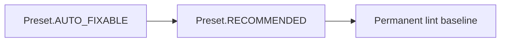
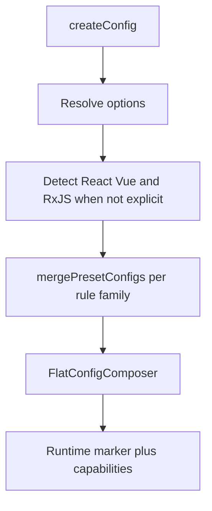
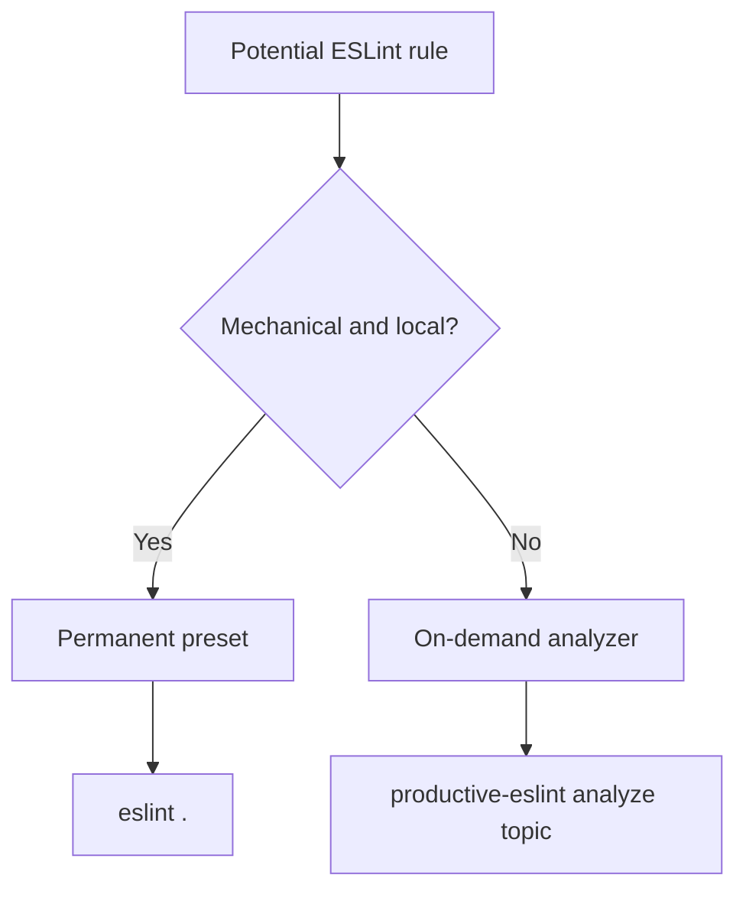

# Configuration Model

The public entry point is `createConfig(options)`.

```ts
import { createConfig, Preset } from 'productive-eslint'

export default createConfig({
  preset: Preset.RECOMMENDED,
})
```

## Presets

`Preset.AUTO_FIXABLE` enables rules with reliable ESLint autofix support.

`Preset.RECOMMENDED` is the default permanent baseline. It includes
`AUTO_FIXABLE` and adds high-value local correctness rules that should stay
visible during ordinary `eslint .` runs.



## Config Composition

Each plugin config exports a preset map with two keys:

- `autoFixable`
- `recommended`

`mergePresetConfigs(map, preset)` composes these layers in order.



The runtime marker is important for the CLI. It lets analyzers verify that the
target project uses a supported `productive-eslint` composer pipeline rather
than an arbitrary ESLint config shape. The same marker carries internal
capability metadata, so CLI analyzers do not need to infer support from the
generated flat-config item layout.

## Optional Frameworks and Tailwind

React, Vue, RxJS, and Tailwind support can be enabled explicitly:

```ts
export default createConfig({
  react: true,
  rxjs: true,
  tailwind: {
    cssConfigPath: 'src/tailwind.css',
  },
  vue: true,
})
```

React keeps backward-compatible boolean usage, but it also accepts a nested
options object:

```ts
export default createConfig({
  react: {
    enabled: true,
    compiler: true,
  },
})
```

Normalization rules are:

- `react: undefined` -> auto-detect React, compiler disabled
- `react: true` -> enable React, compiler disabled
- `react: false` -> disable React and compiler
- `react: { enabled?: boolean, compiler?: boolean }` -> compiler implies React when `enabled` is omitted

`react: { enabled: false, compiler: true }` is invalid and throws a
configuration error because compiler checks are a sub-mode of the React stack.

If an option is omitted, `productive-eslint` tries to detect the package in the
current project. In monorepos, explicit options are usually clearer when the
shared ESLint wrapper is used by many package roots.

Tailwind is explicit-only because the ESLint plugin requires a concrete
`cssConfigPath`. The target project must also have `tailwindcss` installed
before `tailwind: { cssConfigPath }` can be enabled.

For React + shadCN projects, the recommended baseline is:

```ts
import { createConfig, Preset } from 'productive-eslint'

export default createConfig({
  fsd: false,
  preset: Preset.RECOMMENDED,
  react: true,
  tailwind: {
    cssConfigPath: 'src/tailwind.css',
  },
})
```

## Optional FSD Boundaries

FSD architecture setup remains enabled by default for backward compatibility.
Disable it explicitly when the target project does not use the FSD layout:

```ts
export default createConfig({
  fsd: false,
})
```

## Permanent Rules vs Analyzer Rules

Permanent rules should be safe to run during ordinary development. Analyzer
rules are intentionally stronger and more contextual because they are used only
for explicit review commands.

For the current UI layers, the split is:

- React baseline correctness rules, including `jsx-a11y`, stay permanent.
- `react-hooks/rules-of-hooks` stays permanent and runs on `TS` plus `TSX`.
- stronger hook/runtime checks such as `exhaustive-deps`,
  `set-state-in-render`, `globals`, `refs`, and `void-use-memo` stay
  analyzer-only.
- React Compiler readiness checks stay opt-in under
  `react: { compiler: true }`.
- semantic Tailwind checks stay analyzer-only.


